# DisruptionIQ

**From delivery delays to recovery plans.** DisruptionIQ watches inbound shipments and warehouse stock, spots the moment a delay puts customer orders at risk, ranks those orders with a visible explanation, builds four recovery options with their costs, and walks the chosen one through a controlled approval. Every step goes into a tamper-evident audit log.

> **AI advises, logic decides.** Every number (stock, deadlines, risk, cost, permissions) comes from deterministic, tested code. The optional AI layer only writes text about figures already computed. With no API key the product works the same, using template text.

**Live demo:** [web app](https://disruptioniq-sigma.vercel.app) · [API docs](https://disruptioniq-api.onrender.com/docs) (the free API sleeps when idle, so the first request can take about a minute)

All data is **synthetic demo data**. No real customers, suppliers or carriers are involved.

## What it does

| | |
|---|---|
| **Ingest** | CSV or JSON import with row-level validation, plus a signed carrier webhook |
| **Detect** | Late shipments, supplier delays and stock shortages, found by fixed rules |
| **Analyse** | Orders allocated against stock and inbound supply, before and after the delay |
| **Rank** | A 0 to 100 risk score per order from five weighted factors, with a "Why?" breakdown |
| **Recover** | Reallocate, expedite, alternative supplier or split order, each with cost and net benefit |
| **Approve** | Separation of duties and role checks; execution is simulated, never sent to a real system |
| **Contracts** | Upload a customer contract (PDF); the app reads the penalty terms, an AI double-checks them, a manager confirms, and the customer's penalty exposure updates |
| **What-if lab** | Test a supplier shutdown, delay, demand surge or stock cut without touching real data |
| **Audit** | Append-only, hash-chained log with a chain check |

## Architecture and workflow at a glance

GitHub draws the diagrams below in the browser. Eleven more (webhook checks, approval gate, risk score, audit hash chain, data model, a scenario as a sequence) are in [docs/architecture.md](docs/architecture.md).

### System architecture

The web app only displays and sends requests. Everything that decides something is in the API.

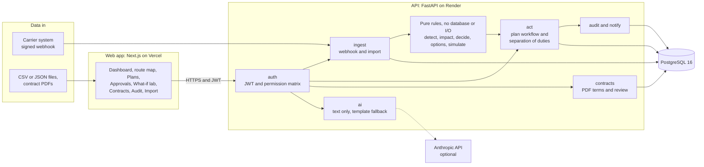

### End-to-end pipeline

How a delay becomes a recovery plan. Dotted lines show where the audit log is written.

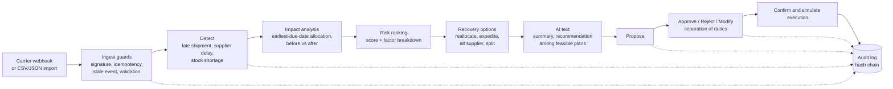

### Plan lifecycle

Each transition needs a person with the right role and is audited.

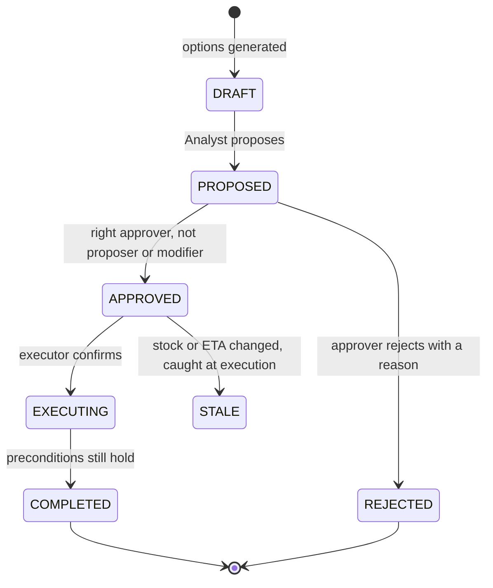

### Who proposes, approves and executes

The approver and the executor depend on the plan type. Nobody approves their own plan, and the person who approves cannot also execute it.

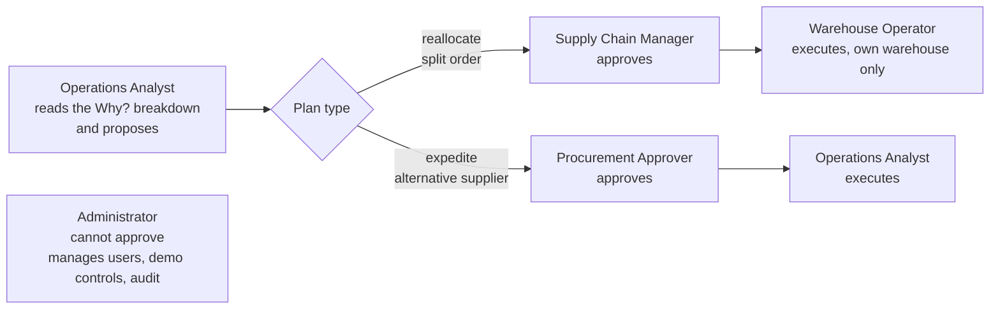

### Request lifecycle inside the API

Every route passes the same path, so a missing permission check fails a test.

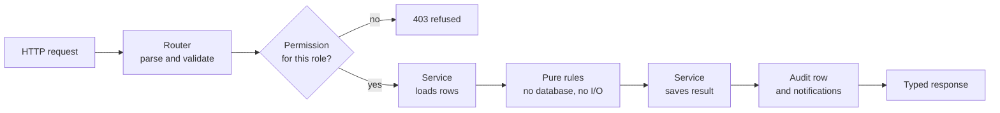

### AI safety guard: advises, never decides

The AI only writes text about numbers the code has already computed. Any problem falls back to a template, so the product works the same with no API key.

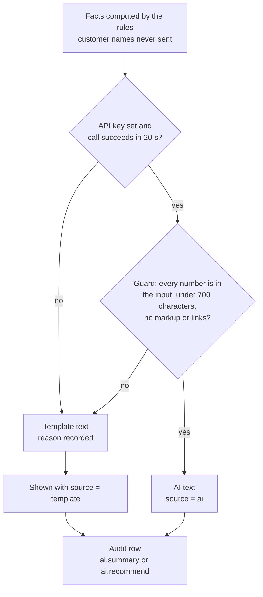

### Safe execution

Approval is not enough: the plan is re-checked against current data at the moment it runs.

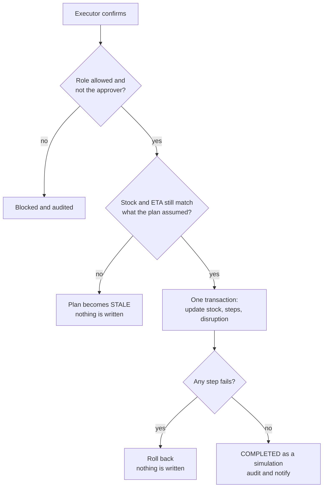

### Contract review

A customer contract changes penalty exposure only after a person confirms it.

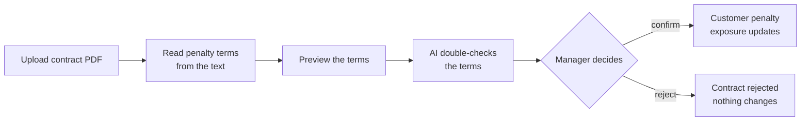

### What-if lab

Test a change on a copy of the current situation. Real data is never touched.

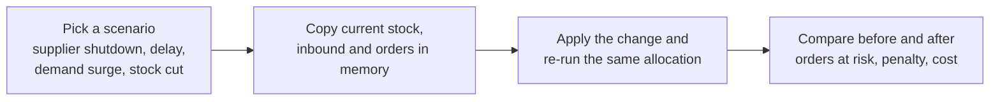

### One typed contract from API to screen

The frontend types are generated from the API, so the two cannot drift apart silently.

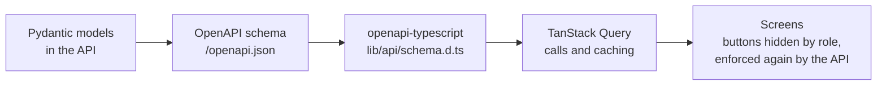

### Deployment layout

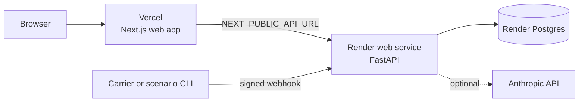

## Repository layout

```
disruptioniq/
├── frontend/   Next.js 16 web app (React 19, TypeScript, Tailwind 4)      -> frontend/README.md
├── backend/    FastAPI service, rules, migrations and tests (Python 3.13) -> backend/README.md
├── docs/       architecture, how it works, demo, deployment, roadmap
├── docker-compose.yml   local Postgres 16
├── render.yaml          Render blueprint (API + database)
└── .env.example         every setting, with safe local defaults
```

| Part | Stack | Hosted on |
|---|---|---|
| Web app | Next.js, TanStack Query, Tailwind, Leaflet, Recharts | Vercel |
| API | FastAPI, Pydantic v2, SQLAlchemy 2, Alembic | Render |
| Database | PostgreSQL 16 | Render |

The web app only displays and sends requests. Everything that decides something lives in the API.

## Run it locally

Needs Docker Desktop, Python 3.13 and Node.js 20+.

```bash
docker compose up -d db                                  # Postgres on port 5433

cd backend
python -m venv .venv
./.venv/Scripts/python -m pip install -r requirements.txt   # macOS/Linux: .venv/bin/python
cp ../.env.example .env
./.venv/Scripts/python -m alembic upgrade head
./.venv/Scripts/python -m app.seed_users
./.venv/Scripts/python -m app.synth --seed 42 --reset
./.venv/Scripts/python -m uvicorn app.main:app --reload     # http://localhost:8000/docs

cd ../frontend                                           # in a second terminal
npm install
echo NEXT_PUBLIC_API_URL=http://localhost:8000 > .env.local
npm run dev                                              # http://localhost:3000
```

Sign in as `analyst@diq.test`, `manager@diq.test`, `operator@diq.test`, `procurement@diq.test` or `admin@diq.test` (password `Demo@12345` in development).

## Documentation

| | |
|---|---|
| [Architecture](docs/architecture.md) | Pipeline, plan lifecycle, data model, deployment layout and project structure, with diagrams |
| [How it works](docs/how-it-works.md) | Risk score, recovery options, safety guards, roles and permissions, API routes |
| [Demo walkthrough](docs/demo.md) | The two scripted scenarios and a suggested live flow |
| [Configuration and deployment](docs/deployment.md) | Environment variables, testing, Render and Vercel steps, known limits |
| [Roadmap](docs/roadmap.md) | What is done and what is planned next |
| [Build blueprint](docs/blueprint.md) | The original 10-hour plan and requirement traceability |

## Tests

```bash
cd backend && ./.venv/Scripts/python -m pytest -q     # 445 tests; needs the Postgres container
cd frontend && npm run lint && npm run build
```
