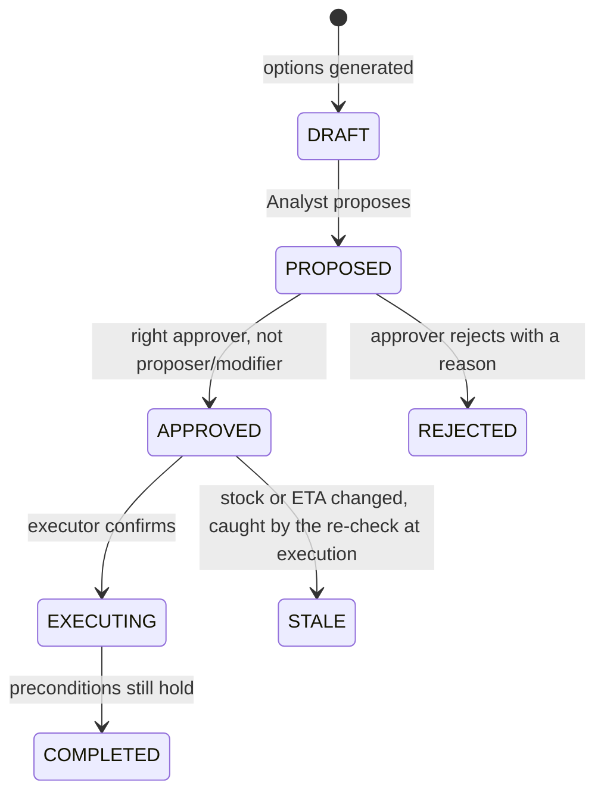
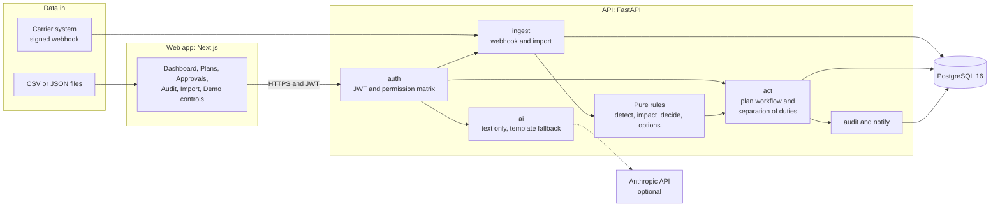
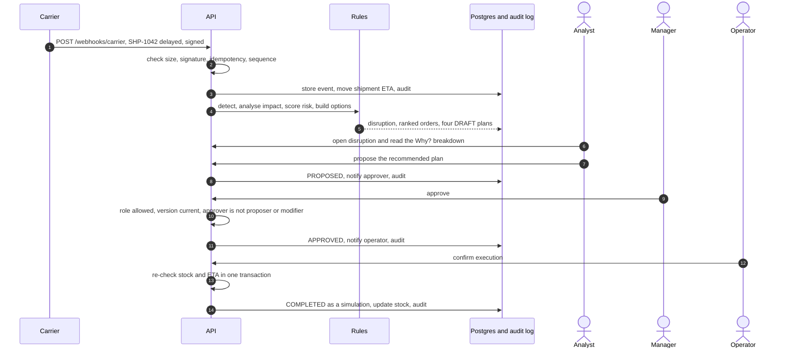
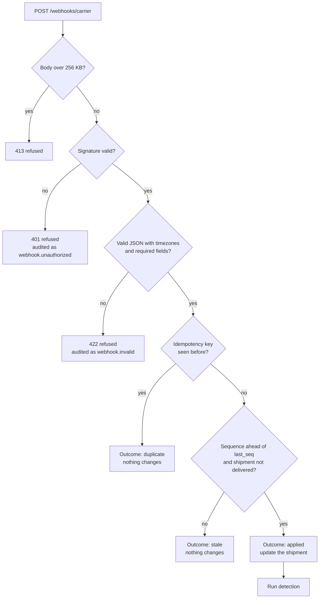
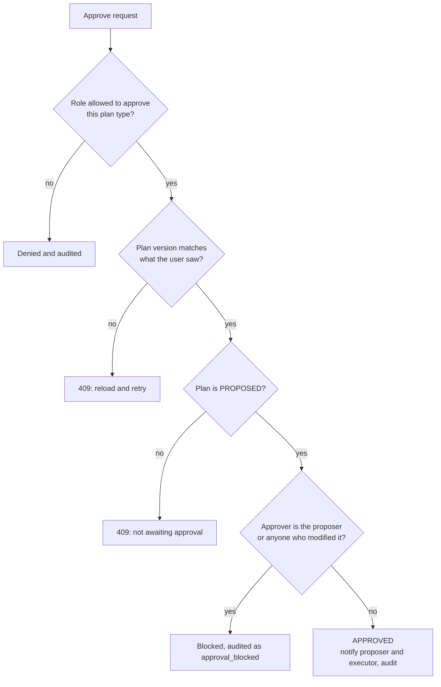
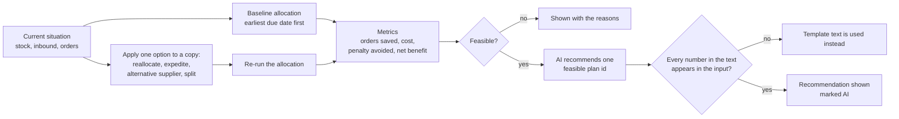
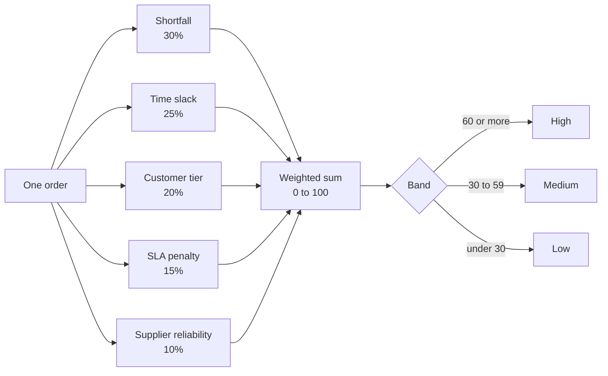
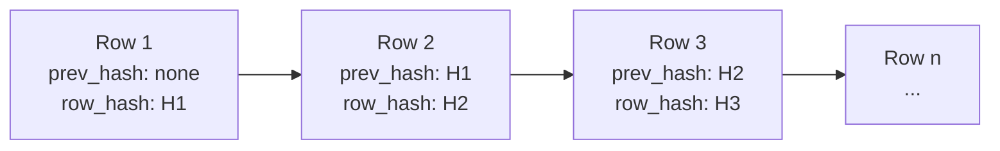
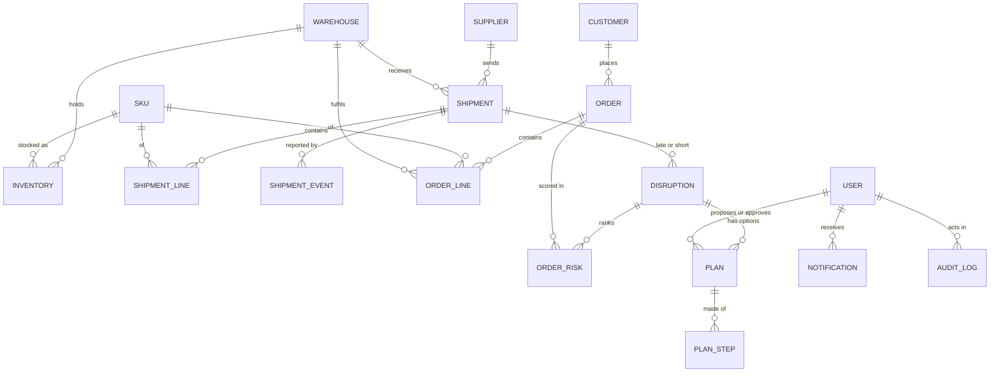
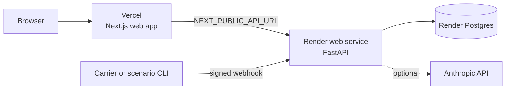

# DisruptionIQ

**From delivery delays to recovery plans.** DisruptionIQ watches inbound shipments and warehouse stock, spots the moment a delay puts customer orders at risk, ranks those orders by risk with a visible explanation, builds four recovery options with their costs, and walks the chosen one through a controlled approval before simulating its execution. Every step is written to a tamper-evident audit log.

> **Guiding rule: AI advises, logic decides.** Every number (stock, deadlines, risk scores, costs, permissions) comes from deterministic, tested code. The AI layer only writes text about figures that are already computed, or picks one plan from the feasible ones the rules built. With no API key the product works identically, using template text.

> All data in this repository is **synthetic demo data** generated by `python -m app.synth`. No real customers, suppliers or carriers are involved.

---

## Contents
1. [What it does](#what-it-does)
2. [Workflow diagrams](#workflow-diagrams)
3. [Quick start](#quick-start)
4. [Demo walkthrough](#demo-walkthrough)
5. [Roles and permissions](#roles-and-permissions)
6. [How the numbers are computed](#how-the-numbers-are-computed)
7. [Safety guards](#safety-guards)
8. [API overview](#api-overview)
9. [Architecture and project layout](#architecture-and-project-layout)
10. [Configuration](#configuration)
11. [Testing](#testing)
12. [Deployment](#deployment)
13. [Hardening and known limits](#hardening-and-known-limits)
14. [Status](#status)

---

## What it does

| Capability | How |
|---|---|
| **Ingest data** | CSV or JSON import of orders, inventory and shipments with row-level validation and an error report; a signed carrier webhook for shipment events. |
| **Detect disruptions** | Rules find late shipments, supplier delays and stock shortages after every applied webhook event or import, or on demand. |
| **Analyse impact** | Orders are allocated against stock and inbound supply in earliest-due-date order, before and after the delay, to show which orders are *newly* at risk. |
| **Rank by risk** | A 0 to 100 score per order from five weighted factors, with a "Why?" breakdown you can open per order. |
| **Recommend recovery** | Four candidate plans per disruption: reallocate from another warehouse, expedite, use an alternative supplier, or split the order. Each shows cost, orders saved, penalty avoided and net benefit, or the reasons it is infeasible. |
| **Approve safely** | Plans move DRAFT, PROPOSED, APPROVED, EXECUTING, COMPLETED. Approval needs a different person from the proposer and from anyone who modified the plan, and the right role for the plan type. |
| **Simulate execution** | Only after approval and an explicit confirmation, re-checking preconditions in one transaction. Nothing touches a real carrier or ERP. |
| **Notify** | In-app notifications to the proposer and approver on every transition. |
| **Audit** | Append-only, hash-chained log of every state change, import, webhook outcome and blocked action, with a chain check page. |
| **Dashboard** | Active disruptions, orders at risk, pending approvals, recovery progress, ranked orders, a street map of the supplier-to-warehouse route with the late shipment on it (OpenStreetMap tiles, internet needed; a Ripple tab shows how one delay spreads to customers), an AI recommendation card, and plan comparison. |

## Workflow diagrams

Eleven diagrams explain how the system works, from the big picture to individual decisions. GitHub renders them in the browser.

### 1. End-to-end pipeline

How a delay becomes a recovery plan. Dotted lines show where the audit log is written.


### 2. Plan lifecycle

The states a recovery plan moves through. Proposing, approving, rejecting and confirming execution each need a person with the right role, and every transition is audited.



### 3. System architecture

The pieces and how they connect. Everything that decides something is in the API; the web app only displays and sends requests.



### 4. Scenario 1 as a sequence: who does what, and when

The port-delay scenario from the first webhook to a completed plan, showing which role acts at each step.



### 5. Carrier webhook: every check, in order

What happens to one incoming event. Every outcome is stored and audited, including the refusals.



### 6. Approval gate: why a plan can be blocked

The checks an approval request passes, in the order the service applies them.



### 7. Recovery options: from candidates to a recommendation

Each option is tried on a copy of the current situation and measured by re-running the allocation. The AI only chooses among the feasible results.



### 8. Risk score: five factors into one number

Each order gets a score from 0 to 100 and keeps the contribution of every factor, which is what the Why? drawer shows.



### 9. Audit log: a hash chain

Each row stores the hash of the row before it, so changing or removing any row breaks every hash after it. A database trigger also blocks updates and deletes, and `GET /audit/verify` recomputes the whole chain.



`row_hash` covers the previous hash, time, actor, role, action, entity, reason and payload.

### 10. Data model

How the main tables link. Import batches, import errors and transfer costs are left out to keep it readable.



### Deployment layout

Locally everything runs on your machine with Postgres in Docker; in the cloud the three parts are hosted separately.



## Quick start

**Prerequisites:** Docker Desktop, Python 3.13, Node.js 20+.

```bash
# 1. Database (Postgres 16 on host port 5433)
docker compose up -d db

# 2. Backend
cd backend
python -m venv .venv
./.venv/Scripts/python -m pip install -r requirements.txt      # Windows; use .venv/bin/python on macOS/Linux
cp ../.env.example .env                                         # then edit if you like; defaults work for local use
./.venv/Scripts/python -m alembic upgrade head                  # create the schema
./.venv/Scripts/python -m app.seed_users                        # the five demo users
./.venv/Scripts/python -m app.synth --seed 42 --reset           # repeatable synthetic data
./.venv/Scripts/python -m uvicorn app.main:app --reload         # API on http://localhost:8000 (docs at /docs)

# 3. Frontend (new terminal)
cd frontend
npm install
echo NEXT_PUBLIC_API_URL=http://localhost:8000 > .env.local
npm run dev                                                     # http://localhost:3000
```

Sign in with any demo user (password `Demo@12345` in development):

| User | Role | Notes |
|---|---|---|
| `analyst@diq.test` | Ops Analyst | Imports data, proposes plans, executes expedite and alt-supplier plans |
| `manager@diq.test` | Supply Chain Manager | Approves reallocate and split plans, reads the audit log |
| `operator@diq.test` | Warehouse Operator | Chennai only; executes reallocate and split plans |
| `procurement@diq.test` | Procurement Approver | Approves expedite and alt-supplier plans |
| `admin@diq.test` | Administrator | Manages users, runs demo controls; **cannot approve plans** |

## Demo walkthrough

Two scripted scenarios fire events through the **real** webhook and import endpoints, so every guard runs for real. The API must be running and the demo data loaded.

```bash
cd backend
./.venv/Scripts/python -m app.scenarios s1            # Scenario 1
./.venv/Scripts/python -m app.scenarios s2            # Scenario 2
./.venv/Scripts/python -m app.scenarios s1 --replay   # resend the last event: the duplicate guard rejects it
```

**Scenario 1: port delay.** Carrier webhook pushes shipment `SHP-1042` (supplier *Coastal Polymers* into the Chennai warehouse) six days late. Six to seven Chennai orders become at risk. The best option is typically to reallocate stock from Bengaluru.

**Scenario 2: partial delivery plus demand spike.** Shipment `SHP-1077` (*Metro Components* into Mumbai) delivers 55% of the order, then a burst of four new Mumbai orders is imported. Projected stock runs out before the next delivery.

Suggested live flow:

1. Sign in as the **Analyst**, fire a scenario, open the new disruption, and click an order to see the *Why?* factor breakdown.
2. Compare the four plans side by side, then **Propose** the recommended one.
3. Sign in as the **Manager** (or Procurement, depending on plan type) and **Approve**. Try approving as the Analyst to see the blocked attempt appear in the audit log.
4. Sign in as the **Operator** and confirm execution of a reallocate plan; watch recovery progress change.
5. Open **Audit** as Manager and run the chain check.
6. As **Admin**, open **Demo controls** to trigger a duplicate webhook, a stale event, a self-approval and a double approval on purpose. Each runs a real guard and writes a `demo.*` audit row.

## Roles and permissions

Enforced in the backend on every route (`backend/app/auth/permissions.py`). The UI hides buttons a role cannot use, but it is never the source of truth. A test fails if the frontend's copy of the matrix drifts from the backend's.

| Permission | Analyst | Manager | Operator | Procurement | Admin |
|---|:-:|:-:|:-:|:-:|:-:|
| View disruptions and plans | yes | yes | own warehouse | yes | yes |
| Import data | yes | | | | yes |
| Run detection | yes | yes | | | yes |
| Use AI text | yes | yes | | yes | |
| Propose a plan | yes | | | | |
| Modify a plan | yes | yes | | yes | |
| Approve reallocate / split | | yes | | | |
| Approve expedite / alt supplier | | | | yes | |
| Confirm execution of reallocate / split | | | yes | | |
| Confirm execution of expedite / alt supplier | yes | | | | |
| Read audit log | | yes | | yes | yes |
| Manage users | | | | | yes |
| Demo controls | | | | | yes |

Separation of duties, checked in the service layer: the approver is never the proposer or anyone who modified the plan; the executor is never the approver; the Administrator has no approval rights. Blocked attempts are recorded in the audit log.

## How the numbers are computed

Everything in this section is plain, pure functions with unit tests. No AI is involved.

**Impact analysis.** For each warehouse and SKU, demand (orders) is matched against on-hand stock and inbound shipments in earliest-due-date order. Running this twice, with the original and the delayed arrival date, shows which orders are *newly* at risk.

**Risk score (0 to 100)** is a weighted sum of five factors; the breakdown is stored and shown per order:

| Factor | Weight | Meaning |
|---|:-:|---|
| Shortfall | 30% | Share of the order quantity that cannot be covered |
| Time | 25% | Slack between the new arrival and the due date (none or negative = 1.0, up to 2 days = 0.6, else 0.2) |
| Customer tier | 20% | Gold 1.0, Silver 0.7, Bronze 0.4 |
| SLA penalty | 15% | Contract penalty, capped at INR 50,000 |
| Supplier | 10% | Lower supplier reliability (0 to 100) raises the risk |

Bands: **high** at 60 or above, **medium** at 30 or above, otherwise **low**.

**Recovery options** (`backend/app/options/`):

| Option | Idea |
|---|---|
| Reallocate | Move surplus stock from another warehouse, at the lane's transfer cost and lead time |
| Expedite | Pay a fee to pull the inbound shipment forward |
| Alternative supplier | Order from another supplier for the shortfall, at a fee |
| Split order | Ship what is available now and the remainder later |

Each plan reports cost, orders saved, penalty avoided and net benefit. *Orders saved* comes from re-running the allocation with the option applied, not from an estimate. Tunable constants live at the top of `backend/app/options/base.py`.

**AI layer** (`backend/app/ai/`, optional). It writes a disruption summary, recommends one of the feasible plans, and explains one order's risk. Its output must pass a check that every number in it appears in the input; an invented number, an unknown plan id, an API error or a missing key falls back to a template. Each answer reports its `source` (`ai` or `template`). `ai/client.py` is the only file that imports the SDK.

## Safety guards

| Risk | Guard |
|---|---|
| Duplicate carrier event | Idempotency key with a UNIQUE index |
| Out-of-order or stale event | Per-shipment sequence number check |
| Forged webhook | HMAC-SHA256 signature (`X-Signature: sha256=<hex>`), body capped at 256 KB |
| Bad import rows | Row-level validation; good rows load, bad rows come back with a reason |
| Two people editing one plan | Optimistic locking on `version` (409 on conflict) |
| Two simultaneous proposals or detections | Row lock plus Postgres advisory lock, backed by partial unique indexes |
| Plan outdated by new data | Precondition re-check at execution, inside one transaction; a plan that no longer holds becomes STALE |
| Self-approval, double approval | Service-layer separation of duties |
| Silent tampering with history | Audit log is append-only (database trigger) and hash-chained (`prev_hash`, `row_hash`) |
| Credential guessing | 8 failed sign-ins in 10 minutes per email or address returns 429, audited |
| Weak production secrets | `ENVIRONMENT` other than development refuses default or short secrets and the public demo password |
| Operators seeing other sites | Warehouse filter applied inside the query, not after it |

## API overview

Interactive docs are served at `http://localhost:8000/docs`. Main routes:

| Area | Routes |
|---|---|
| Auth | `POST /auth/login`, `GET /auth/me` |
| Import | `POST /import/csv?entity=orders\|inventory\|shipments` (file upload), `POST /import/json`, `GET /import/batches`, `GET /import/batches/{id}` |
| Webhook | `POST /webhooks/carrier` |
| Disruptions | `GET /disruptions`, `POST /disruptions/detect`, `GET /disruptions/{id}`, `GET /disruptions/{id}/orders` |
| Plans | `GET /disruptions/{id}/plans`, `POST /disruptions/{id}/plans/generate`, `GET /plans`, `POST /plans/{id}/propose\|modify\|approve\|reject\|execute` |
| AI | `GET /ai/status`, `POST /ai/disruptions/{id}/summary`, `/recommend`, `/orders/{order_id}/explain` |
| Notifications | `GET /notifications`, `POST /notifications/read-all`, `POST /notifications/{id}/read` |
| Audit | `GET /audit`, `GET /audit/verify` |
| Users | `GET /users`, `POST /users` (Administrator) |
| Demo controls | `GET /demo/targets`, `POST /demo/replay-duplicate\|stale-event\|self-approval\|double-approve` (Administrator) |
| Health | `GET /health` |

After changing the API, regenerate the frontend types with `npm run gen:api` (API must be running).

## Architecture and project layout

```
disruptioniq/
├── backend/                  FastAPI service
│   ├── app/
│   │   ├── ingest/           import service, webhook handling, signature check
│   │   ├── detect/           pure detection rules
│   │   ├── impact/           pure earliest-due-date allocation
│   │   ├── decide/           pure risk scoring
│   │   ├── options/          pure recovery-option generators and metrics
│   │   ├── act/              plan state machine, separation of duties, execution
│   │   ├── ai/               the only place an LLM is imported; template fallbacks
│   │   ├── auth/             JWT, permission matrix
│   │   ├── audit/            hash-chained audit log
│   │   ├── notify/           in-app notifications
│   │   ├── demo/             deliberate guard demonstrations
│   │   ├── synth/            seeded synthetic data generator
│   │   ├── scenarios/        CLI that fires scenarios 1 and 2 through the real endpoints
│   │   ├── routers/          HTTP layer
│   │   └── models.py         SQLAlchemy models (21 tables)
│   ├── alembic/              migrations
│   └── tests/                pytest suite
├── frontend/                 Next.js 16 App Router, React 19, TypeScript
│   ├── app/                  pages: dashboard, disruptions, plans, approvals, audit, import, demo, login
│   ├── components/           dashboard panels, ripple map, plan controls, shared UI
│   └── lib/                  API client, generated OpenAPI types, view-model adapters
├── docker-compose.yml        Postgres 16
├── render.yaml               Render blueprint (API + Postgres)
├── blueprint.md              the build plan and requirement traceability
└── CLAUDE.md                 engineering rules for AI-assisted development
```

**Design rules** (from `CLAUDE.md`): detection, impact, risk and option code are pure functions with no database or I/O; services load data, call the rules, and persist results. The LLM client is imported in exactly one module. Permissions are enforced server-side. Every state change writes an audit row.

**Data model.** Linked tables: warehouses, users, suppliers, SKUs, supplier items, inventory, transfer costs, customers, orders and order lines, shipments, shipment lines and shipment events, import batches and errors, disruptions, order risk, plans and plan steps, notifications, and the audit log.

**Stack.**

| Layer | Technology |
|---|---|
| Backend | FastAPI, Pydantic v2, SQLAlchemy 2, Alembic, PyJWT, httpx |
| Database | PostgreSQL 16 |
| Frontend | Next.js 16 (App Router), React 19, TypeScript, Tailwind 4, shadcn/ui, TanStack Query 5 |
| Visuals | Leaflet (route map), React Flow (ripple map), Recharts (charts) |
| AI (optional) | Anthropic API via a single module |
| Tests | pytest |

## Configuration

Copy `.env.example` to `backend/.env` for the API and set `frontend/.env.local` for the web app.

| Variable | Where | Purpose |
|---|---|---|
| `ENVIRONMENT` | backend | `development` allows the defaults; anything else enforces strong secrets |
| `DATABASE_URL` | backend | Postgres URL (`postgres://` and `postgresql://` are accepted and normalised) |
| `JWT_SECRET` | backend | Signs session tokens; 16+ characters outside development |
| `WEBHOOK_SECRET` | backend | HMAC key the carrier uses to sign webhook bodies |
| `DEMO_PASSWORD` | backend | Password for the five demo users; required outside development |
| `CORS_ORIGINS` | backend | Allowed web origins, comma separated |
| `ANTHROPIC_API_KEY`, `ANTHROPIC_MODEL` | backend | Optional. Unset means template text everywhere |
| `NEXT_PUBLIC_API_URL` | frontend | Base URL of the API |
| `NEXT_PUBLIC_DEMO_PASSWORD` | frontend | Optional. Enables one-click role buttons on the login page. Public in the browser bundle: use only on a clearly marked demo deployment |

## Testing

```bash
cd backend
./.venv/Scripts/python -m pytest -q          # 400+ tests; needs the Postgres container running
cd ../frontend
npm run lint
npm run build
```

Tests are written first for the permission matrix, separation of duties, idempotency, stale events, import validation, impact allocation, risk score, plan metrics, optimistic locking, execution rollback and the AI number check. `backend/tests/test_hardening.py` pins every fix from the security review.

## Deployment

Nothing is deployed until you do it; the steps are manual.

1. **API and Postgres on Render:** push the repo, then *New > Blueprint* and select it (`render.yaml`). Fill in `DEMO_PASSWORD` and `CORS_ORIGINS` when asked. On every start the service runs `alembic upgrade head`, seeds the demo users, loads the synthetic data the first time, then serves. Check `https://<service>.onrender.com/health`.
2. **Web app on Vercel:** import the repo, set the root directory to `frontend`, and add `NEXT_PUBLIC_API_URL=https://<service>.onrender.com`. Then put the Vercel URL into `CORS_ORIGINS` on Render and redeploy the API.
3. **Scenarios against the deployment:** from `backend/`, run `python -m app.scenarios s1 --base-url https://<service>.onrender.com --password <DEMO_PASSWORD>` with `DATABASE_URL` set to the Render database's external URL (the CLI reads the shipment from the database) and `WEBHOOK_SECRET` set to the deployed value (it signs the event).
4. Free Render services sleep when idle (the first request takes about a minute) and free Postgres expires after 30 days: wake it before a demo, and keep a recorded run as a backup.

## Hardening and known limits

A code review and a security review of the whole repository led to the fixes pinned in `backend/tests/test_hardening.py`: partial unique indexes for one in-flight plan per disruption and one active disruption per warehouse and SKU; regenerating options updates draft plans in place so a reviewer's edits survive; production secret checks; the webhook size cap; login throttling; and query-level warehouse filtering for operators.

Known limits:
- Login throttling counters live in process memory, so with several API instances the limit applies per instance.
- The dashboard polls several endpoints per disruption.
- The frontend's role lists are copies of the permission matrix (a test fails if they drift).
- `npm audit` reports low-severity issues in development tooling only.
- Execution is a simulation: it updates the database and writes the audit trail, and contacts no external system.

## Status

Phases 0 to 9 are complete: scaffold, models, auth and audit; synthetic data, import and webhook; detection, impact and risk; recovery options; approval workflow, notifications and simulated execution; AI layer; frontend; hardening, tests and deploy files. The cloud deployment and a backup demo recording are not done.
