# Architecture

How the system fits together: pipeline, workflow, data model, deployment layout and project structure. Back to the [README](../README.md).

## Workflow diagrams

Eleven diagrams explain how the system works, from the big picture to individual decisions. GitHub renders them in the browser.

### 1. End-to-end pipeline

How a delay becomes a recovery plan. Dotted lines show where the audit log is written.

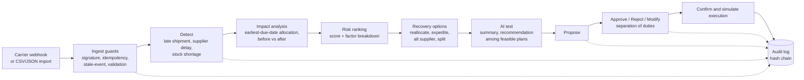

### 2. Plan lifecycle

The states a recovery plan moves through. Proposing, approving, rejecting and confirming execution each need a person with the right role, and every transition is audited.

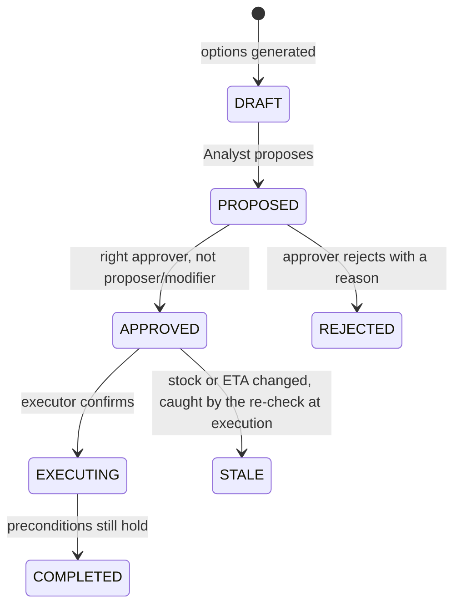

### 3. System architecture

The pieces and how they connect. Everything that decides something is in the API; the web app only displays and sends requests.

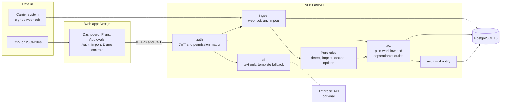

### 4. Scenario 1 as a sequence: who does what, and when

The port-delay scenario from the first webhook to a completed plan, showing which role acts at each step.

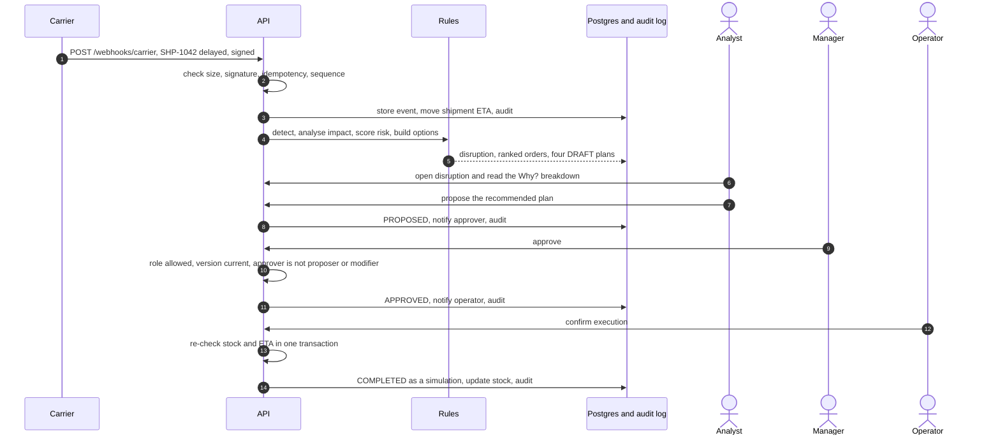

### 5. Carrier webhook: every check, in order

What happens to one incoming event. Every outcome is stored and audited, including the refusals.

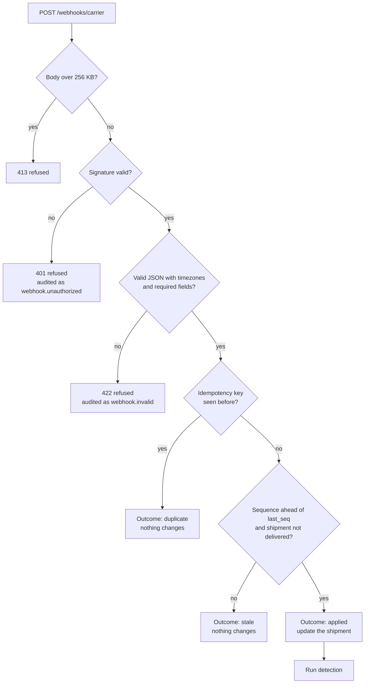

### 6. Approval gate: why a plan can be blocked

The checks an approval request passes, in the order the service applies them.

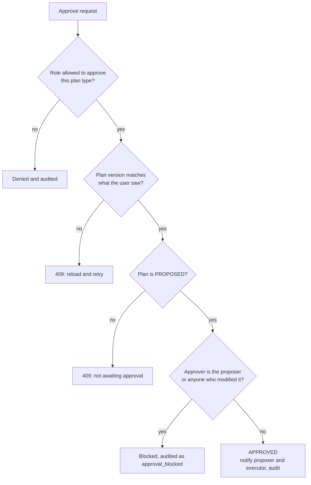

### 7. Recovery options: from candidates to a recommendation

Each option is tried on a copy of the current situation and measured by re-running the allocation. The AI only chooses among the feasible results.

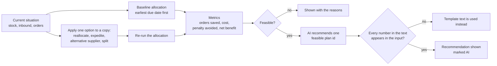

### 8. Risk score: five factors into one number

Each order gets a score from 0 to 100 and keeps the contribution of every factor, which is what the Why? drawer shows.

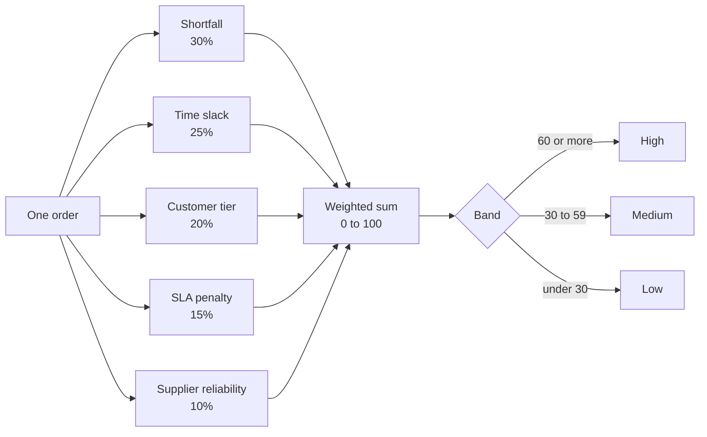

### 9. Audit log: a hash chain

Each row stores the hash of the row before it, so changing or removing any row breaks every hash after it. A database trigger also blocks updates and deletes, and `GET /audit/verify` recomputes the whole chain.

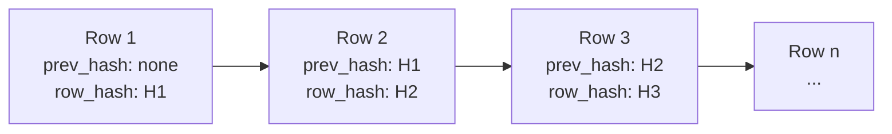

`row_hash` covers the previous hash, time, actor, role, action, entity, reason and payload.

### 10. Data model

How the main tables link. Import batches, import errors and transfer costs are left out to keep it readable.

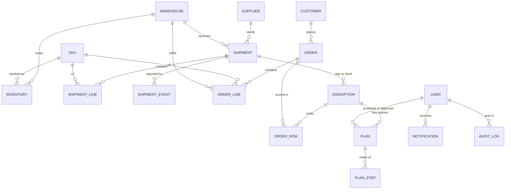

### Deployment layout

Locally everything runs on your machine with Postgres in Docker; in the cloud the three parts are hosted separately.

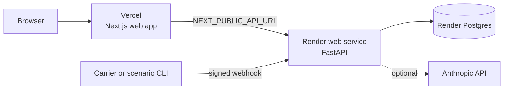

## Architecture and project layout

```
disruptioniq/
├── backend/                  FastAPI service
│   ├── app/
│   │   ├── ingest/           import service, webhook handling, signature check
│   │   ├── detect/           pure detection rules
│   │   ├── impact/           pure earliest-due-date allocation
│   │   ├── decide/           pure risk scoring
│   │   ├── options/          pure recovery-option generators and metrics
│   │   ├── act/              plan state machine, separation of duties, execution
│   │   ├── ai/               the only place an LLM is imported; template fallbacks
│   │   ├── auth/             JWT, permission matrix
│   │   ├── audit/            hash-chained audit log
│   │   ├── notify/           in-app notifications
│   │   ├── demo/             deliberate guard demonstrations
│   │   ├── simulate/         pure what-if engine (supplier shutdown, delay, surge, stock cut)
│   │   ├── synth/            seeded synthetic data generator
│   │   ├── scenarios/        CLI that fires scenarios 1 and 2 through the real endpoints
│   │   ├── routers/          HTTP layer
│   │   └── models.py         SQLAlchemy models (21 tables)
│   ├── alembic/              migrations
│   └── tests/                pytest suite
├── frontend/                 Next.js 16 App Router, React 19, TypeScript
│   ├── app/                  pages: dashboard, disruptions, approvals, what-if lab, audit, import, demo, login
│   ├── components/           dashboard panels, ripple map, plan controls, shared UI
│   └── lib/                  API client, generated OpenAPI types, view-model adapters
├── docker-compose.yml        Postgres 16
├── render.yaml               Render blueprint (API + Postgres)
├── docs/                     architecture, how it works, demo, deployment, roadmap, blueprint
└── CLAUDE.md                 engineering rules for AI-assisted development
```

**Design rules** (from `CLAUDE.md`): detection, impact, risk and option code are pure functions with no database or I/O; services load data, call the rules, and persist results. The LLM client is imported in exactly one module. Permissions are enforced server-side. Every state change writes an audit row.

**Data model.** Linked tables: warehouses, users, suppliers, SKUs, supplier items, inventory, transfer costs, customers, orders and order lines, shipments, shipment lines and shipment events, import batches and errors, disruptions, order risk, plans and plan steps, notifications, and the audit log.

**Stack.**

| Layer | Technology |
|---|---|
| Backend | FastAPI, Pydantic v2, SQLAlchemy 2, Alembic, PyJWT, httpx |
| Database | PostgreSQL 16 |
| Frontend | Next.js 16 (App Router), React 19, TypeScript, Tailwind 4, shadcn/ui, TanStack Query 5 |
| Visuals | Leaflet (route map), React Flow (ripple map), Recharts (charts) |
| AI (optional) | Anthropic API via a single module |
| Tests | pytest |
